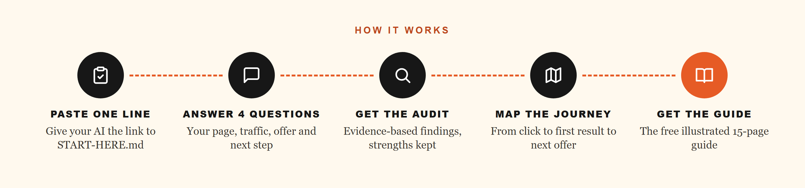
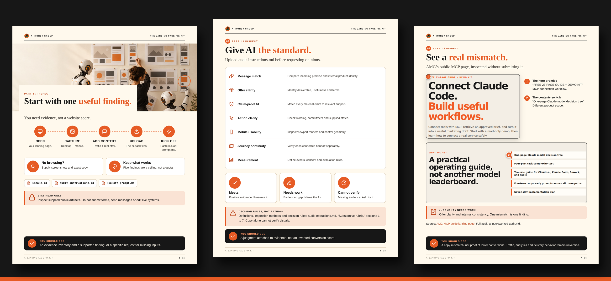

<p align="center"></p>

<p align="center"><a href="https://get.aimoneygroup.com/ai-landing-page-fix-kit?utm_source=github&utm_medium=repo&utm_campaign=landing-page-fix-kit&utm_content=readme-button"></a></p>

<p align="center">
  
  
  
</p>

<!-- amg:optin-banner -->
> **📘 Get the free illustrated AI Landing Page Fix Kit guide.** This folder holds the AI files. The 15-page step-by-step guide with the worked example, visuals and checklists is free here: **[Get the guide →](https://get.aimoneygroup.com/ai-landing-page-fix-kit?utm_source=github&utm_medium=repo&utm_campaign=landing-page-fix-kit&utm_content=readme)**
<!-- /amg:optin-banner -->

## ⚡ Use it in one line
Paste this into Claude, ChatGPT, Claude Code, Codex, Hermes or OpenClaw:

```text
Read https://raw.githubusercontent.com/jeffjhunter/amg-kits/main/landing-page-fix-kit/START-HERE.md and follow it.
```



Can't give your AI a link? Click **Code → Download ZIP** at the top of the repo and upload this folder's files.

## 👀 Inside the free guide
<a href="https://get.aimoneygroup.com/ai-landing-page-fix-kit?utm_source=github&utm_medium=repo&utm_campaign=landing-page-fix-kit&utm_content=readme-preview"></a>

The AI files are half the kit. The 15-page step-by-step guide with the worked example, visuals and checklists shows you *why* each step matters. It's free.

<p align="center"><a href="https://get.aimoneygroup.com/ai-landing-page-fix-kit?utm_source=github&utm_medium=repo&utm_campaign=landing-page-fix-kit&utm_content=readme-button"></a></p>

## 🧰 What's inside
| File | What it's for |
|---|---|
| [`START-HERE.md`](START-HERE.md) | Step-by-step instructions your AI follows |
| [`files/intake.md`](files/intake.md) | Fill this in first: audience, promise, offer, action, what you know and do not know |
| [`files/kickoff-prompt.md`](files/kickoff-prompt.md) | The prompt that starts the audit |
| [`files/audit-instructions.md`](files/audit-instructions.md) | The rubric and rules the AI follows |
| [`files/output-template.md`](files/output-template.md) | Shape of the audit report |
| [`files/journey-template.md`](files/journey-template.md) | Customer journey map template |
| [`files/correction-prompt.md`](files/correction-prompt.md) | Second-pass check of the AI's own report |
| [`files/annotated-examples.md`](files/annotated-examples.md) | Short good/bad examples |
| [`files/worked-audit.md`](files/worked-audit.md) | A real worked audit of a live AI Money Group page |
| [`files/journey-proposal.md`](files/journey-proposal.md) | A worked journey proposal |
| [`files/real-case-page-copy.txt`](files/real-case-page-copy.txt) | Page copy used in the worked audit |
| [`files/real-case-observation.json`](files/real-case-observation.json) | How and when that page was captured |
| [`files/source-ledger.json`](files/source-ledger.json) | Sources cited in the worked audit |

## 🧩 Install as a skill
Copy this folder into your skills directory (Claude Code: `~/.claude/skills/landing-page-fix-kit/`, Hermes: `~/.hermes/skills/`).
`SKILL.md` is the entry point.

---

<p align="center"><b>Building more with AI?</b> Classrooms, live calls and every kit's full guide.<br><br>
<a href="https://aimoneygroup.com/?utm_source=github&utm_medium=repo&utm_campaign=landing-page-fix-kit&utm_content=readme-amg"></a></p>

<p align="center"><sub>Free to use for your own business. Please don't resell or republish the kit as your own.
Made by Jeff J Hunter · AI Money Group</sub></p>
